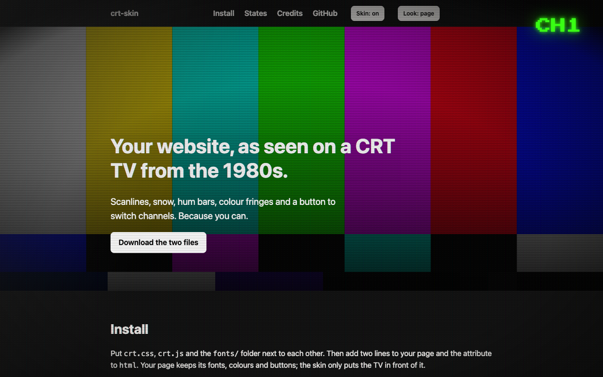

# crt-skin

Turn any website into a picture on an old tube TV. Scanlines, snow, hum bars, colour fringes, a channel button. No build step, no framework, nothing loaded from outside.

[](https://tbx.github.io/crt-skin/demo/)

Demo: https://tbx.github.io/crt-skin/demo/

The look follows [GOROman's Famicom RF decoder](https://github.com/GOROman/famicom-rf-hackrf-decoder): a page received over the antenna, not rendered on a display.

## Install

Put `crt.css`, `crt.js` and the `fonts/` folder next to each other. Add two lines to your page:

```html
<html data-skin="crt">
  <link rel="stylesheet" href="crt.css">
  <script src="crt.js"></script>
```

Load the script in the `<head>` without `defer`. It is small, and that way the attribute is set before the first paint, so nothing jumps.

Leave `data-skin="crt"` out and the skin stays off until a visitor opens the page with `?skin=crt`. The choice is remembered in `localStorage`, `?skin=off` clears it. Both work whether the attribute is in your HTML or not.

The content that should wave during interference needs to sit inside a `<main>` element. Everything else works on any markup.

## What it does

- **Power on.** The picture comes in disturbed: snow, hum bar, the content waves. After three seconds it settles. Headings carry colour fringes and snap into focus as they enter the screen.
- **Reception.** Leave the page alone for ten seconds and the signal drifts for four. Any touch, key, scroll or mouse move brings it back. On Android a shake counts too. While you scroll, the fringes widen.
- **Channels.** The pulsing `CH1` top right switches channels. CH1 is your page. CH2 is static, every click returns, after ten seconds it returns by itself. CH3 shows an image or video of your choice and is off unless you set one. Keys 1 to 3 and the arrow keys switch too.
- **Weak hardware.** Reduced motion, data saver, little memory, few cores, or a short frame test under about 45 fps after load switch to a lite mode: scanlines and vignette stay, nothing animates, text stays sharp. The result is kept for the session. `?crt=lite` forces it, `?crt=full` turns it off.

## Typography

Press Start 2P (SIL Open Font License, included in `fonts/`) is used for `h1`, `h2`, the channel button, markers and anything you mark with `data-crt="title"`. Everything else keeps the font of your site. Sizes are fixed pixel steps (40, 32, 24 for `h1`, 24 and 16 for `h2`) because the font is an 8 px grid and fractional sizes make the pixels uneven.

## Hooks

The skin styles plain elements: headings, paragraphs, links, `nav`, `header`, `footer`, `main`, images, form fields, buttons, `hr`, `pre`. A few optional attributes give it more to work with:

| Attribute | Effect |
| --- | --- |
| `data-crt="hero"` | A section with a photo: saturated like NTSC chroma, darkened from below, a second layer of scanlines. Children other than the image are raised above the gradient. |
| `data-crt="photo"` | A figure with a frame and a colour fringe. |
| `data-crt="title"` | Any element in the heading style, for example a quote. It snaps into focus like a heading. |
| `data-crt="marker"` | Small pixel labels like A, B, C. |
| `data-crt="button"` | A link that looks like a button. |
| `data-crt="muted"` | Dimmed text. |

## Channel 3

Give the script tag an image or video and CH3 appears:

```html
<script src="crt.js" data-ch3="late-night.mp4" data-ch3-label="Channel 3: late night"></script>
```

The file is only loaded when someone switches to CH3. Videos play muted and looped. `data-label` sets the screen reader text of the channel button (default "Switch channel").

## JavaScript API

`window.crtSkin` has `on()`, `off()`, `toggle()`, `isOn()` and `channel(n)`. The demo uses `toggle()` for its on/off switch.

## Adjusting

All colours and the position of the channel button are custom properties on `html[data-skin="crt"]`:

```css
html[data-skin="crt"] {
  --crt-ch-top: 20px;
  --crt-ch-right: 20px;
  --crt-lime: #39ff14;
}
```

Every rule in `crt.css` sits under `html[data-skin="crt"]:not(#_)`, which gives it ID specificity so it wins over your component styles without `!important`. To override something, use the same prefix.

## States

The script sets these attributes on `html`; the CSS reacts to them:

| Attribute | Meaning |
| --- | --- |
| `data-crt="stable"` | The picture stands. Without it: snow, hum bar, waves. |
| `data-crt-scrolling` | Set while scrolling. |
| `data-crt-ch="2"` or `"3"` | Current channel other than CH1. |
| `data-crt-lite` | Lite mode for weak hardware. |

## Things learned the hard way

- iOS Safari clips fixed layers at the status bar and the Safari bar. The scanlines are therefore an absolute, document sized layer on the content, and channel 3 is an absolute document layer with a `position: sticky` screen inside.
- No `overflow: hidden` on `body` for full screen channels: on desktop the scrollbar disappears and fixed elements jump. `touch-action: none` on the layer does the job.
- Waves are `translateX` only, never `skewX`. On a very tall `main`, half a degree tips the content by 60 px and creates horizontal scrolling. `overflow-x: clip` on `body` catches the rest.
- Scanlines over body text stay at about 12 percent opacity. Headings and photos get a second layer.

## Development

`crt.js` is built from `src/crt.ts` with esbuild and the built file is in the repo, so users need no tooling.

```bash
npm install
npm run build
```

`npm run demo` serves the repo on port 8765, the demo is at `/demo/`.

## License

MIT, see `LICENSE`. Made by [@tbx](https://x.com/tbx). Press Start 2P by CodeMan38 under the SIL Open Font License, see `fonts/LICENSE-OFL.txt`.
